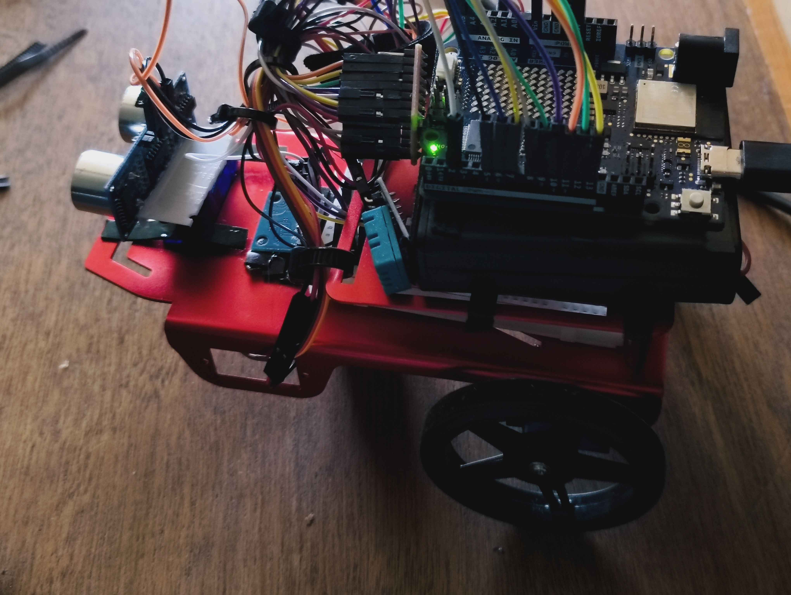

# Constrained-Sensor Autonomous Robot

An experimental autonomous mobile robot capable of performing environment mapping and particle-filter-based localisation using highly constrained sensing hardware.

A Python-based navigation agent communicates with an ESP32 controller over Wi-Fi, performing pose estimation, point-map construction, landmark extraction and autonomous navigation.

The system uses only an MPU-6050 IMU and a servo-mounted HC-SR04 ultrasonic sensor for environmental sensing, generating pseudo-2D scans without relying on cameras, LiDAR or GPS.

## Hardware

The robot consists of the following components:

- **ESP32:** Microcontroller responsible for hardware control and communication with the Python agent.
- **MPU-6050:** Inertial measurement unit providing gyroscopic orientation measurements.
- **HC-SR04:** Ultrasonic distance sensor used to detect surrounding obstacles.
- **Servo motor:** Rotates the ultrasonic sensor to collect distance measurements across a range of angles.
- **Mobile robot platform:** Motorised chassis providing autonomous movement and navigation.

### Robot photographs

## System Architecture

The project is divided into two main components:

### 1. ESP32 Firmware (C++)

The microcontroller handles physical robot operations, including motor control, sensor readings, ultrasonic scanning, IMU calibration and Wi-Fi TCP communication.

### 2. Python Navigation Agent

The Python application processes incoming sensor data, estimates the robot's position, constructs an environmental map, identifies landmarks and determines navigation commands.

The two components communicate through a TCP socket over Wi-Fi.

### Processing Pipeline

1. The ESP32 collects ultrasonic distance measurements and orientation data.
2. The Python agent receives sensor scans and robot motion information over TCP.
3. A particle filter estimates the robot's position and orientation.
4. Incoming scans are transformed into world coordinates and incorporated into an accumulated map.
5. DBSCAN clustering and RANSAC line fitting identify potential environmental landmarks.
6. A landmark association mechanism tracks detected features across successive observations.
7. Navigation logic determines movement commands for exploration or return-to-origin behaviour.

## Algorithms and Implementation

The project implements several core algorithms from scratch using Python, without relying on dedicated machine-learning or robotics libraries for the core localisation and mapping algorithms.

### Particle Filter Localisation

A particle-filter-based localisation system maintains a population of 120 particles, each representing a possible robot pose consisting of position and orientation.

- Gaussian noise is introduced into the motion model to account for movement uncertainty.
- Gyroscopic orientation updates are incorporated into particle motion estimates.
- Incoming ultrasonic scans are transformed into world coordinates using each particle's estimated pose.
- Particle weights are calculated using scan-to-map likelihood scoring, based on the proximity of observed points to the existing global map.
- Particle resampling redistributes the particle population according to the calculated weights.

### Environmental Mapping

Ultrasonic measurements collected during servo rotation are transformed into Cartesian coordinates using the estimated robot pose.

A global point map is incrementally constructed as the robot explores its environment.

To reduce noise and repeated measurements, the mapping pipeline incorporates spatial consolidation:

- Points are grouped into a 5 cm grid.
- Cells with insufficient repeated observations are filtered out.
- The resulting point map is used for scan matching and landmark detection.

### Landmark Detection

A custom landmark detection pipeline identifies linear environmental features from the accumulated point map.

The implementation consists of:

- **DBSCAN:** Custom density-based clustering algorithm used to group spatially related points.
- **RANSAC:** Random Sample Consensus used to identify candidate lines within individual clusters and reject outliers.
- **Least-squares refinement:** Refines line estimates using identified inliers.
- **Landmark association:** Matches newly detected lines against previously identified landmarks using angular and spatial similarity.
- **Exponential smoothing:** Gradually updates landmark estimates as they are observed repeatedly.

